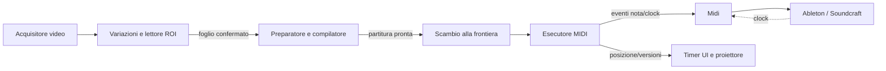

# Architettura

Soluzione a cinque progetti (vedi `src/VisualMusicBlockLooper.sln`):

| Progetto | Responsabilità | Dipendenze |
|---|---|---|
| Core | Griglia, cartoncini, sequencer, clock/tempo, trasporto, parser payload, eventi musicali | nessuna |
| Vision | Acquisizione webcam, rilevamento QR, classificazione colore, misura larghezza, omografia camera→proiettore | OpenCvSharp, Core |
| Midi | Invio note per canale, MIDI Clock, Start/Stop/Continue, ricezione clock | DryWetMIDI, Core |
| App | Form di controllo, form proiettore a schermo intero, composizione dei moduli | tutti |
| Tests | Unit, smoke, fuzzing | NUnit |

Core espone interfacce (`IRilevatoreCartoncini`, `IUscitaMidi`, `IIngressoMidi`, `IMotoreMusicale`) implementate dagli altri livelli e sostituibili nei test. Il runtime principale usa `EsecutoreMidi`/`MotorePartitura`; `MotoreMusicale` resta disponibile per compatibilità e simulazioni.

Il [modello produttore–consumatore](esecuzione-midi.md) separa acquisizione, analisi e compilazione dal clock. `PreparatoreFoglio` produce eventi immutabili; `ScambioPartiture` pubblica una sola versione pronta. `MotorePartitura` consuma il buffer attivo e sostituisce il riferimento alla frontiera del giro. I messaggi del driver vengono preparati prima della pubblicazione. Solo l'esecutore modifica trasporto e invia MIDI; comandi/UI/callback consegnano richieste limitate, con Stop prioritario.

