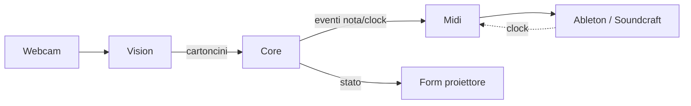

# Architettura

Soluzione a cinque progetti (vedi `src/VisualMusicBlockLooper.sln`):

| Progetto | Responsabilità | Dipendenze |
|---|---|---|
| Core | Griglia, cartoncini, sequencer, clock/tempo, trasporto, parser payload, eventi musicali | nessuna |
| Vision | Acquisizione webcam, rilevamento QR, classificazione colore, misura larghezza, omografia camera→proiettore | OpenCvSharp, Core |
| Midi | Invio note per canale, MIDI Clock, Start/Stop/Continue, ricezione clock | DryWetMIDI, Core |
| App | Form di controllo, form proiettore a schermo intero, composizione dei moduli | tutti |
| Tests | Unit, smoke, fuzzing | NUnit |

Core espone interfacce (`IRilevatoreCartoncini`, `IUscitaMidi`, `IOrologio`) implementate da Vision e Midi e sostituibili con finti nei test.

