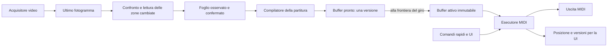

# Esecuzione MIDI per giro

Il runtime della finestra principale usa un produttore e un consumatore. Il produttore interpreta il foglio e prepara una sequenza immutabile di eventi. Il consumatore è l'unico thread che invia note, Clock e trasporto MIDI: legge eventi già ordinati, senza chiamare camera, decoder o interfaccia.



## Termini e scadenze

| Termine | Significato |
| --- | --- |
| Rigo | Riga fisica della griglia; le righe collegate dello stesso gruppo suonano in sequenza. |
| Misura | 2, 3 o 4 pulsazioni, secondo MISURA. |
| Pulsazione | Un quarto, quattro step. Il vecchio nome «battuta» nei payload A–B indica questa unità. |
| Step | Un sedicesimo, sei tick MIDI. |
| Giro | Intero intervallo A–B della struttura attiva. |
| Frontiera | Confine di adozione: misura assoluta per gli aggiornamenti live delle note; giro A-B per le modifiche strutturali. |

All'inizio dell'ultima misura toccata dal giro, il produttore congela l'ultima osservazione confermata e prepara il prossimo buffer. Per un giro più corto di una misura la scadenza coincide con l'inizio del giro. Una lettura confermata dopo la scadenza viene considerata per una preparazione successiva. Il consumatore continua il giro attivo senza aspettare il produttore; una preparazione tardiva entra a una frontiera successiva e, nel frattempo, si ripete il buffer valido. In Stop una nuova versione confermata viene preparata subito.

Il buffer ordinario contiene una versione recente; gli aggiornamenti live delle note hanno una coda limitata di partiture future, con generazione geometrica e misura assoluta di adozione. Pubblicazioni vecchie non sostituiscono versioni nuove. Un cambio di struttura viene applicato interamente al confine A-B; gli aggiornamenti delle note entrano al confine della misura destinataria, conservando i NoteOff delle note già iniziate. Una preparazione tardiva attende la successiva occorrenza della stessa misura.

## Lettura e comandi

Il primo foglio viene letto da **una sola istantanea**: decodifica rapida ZXing, validazione dei payload e dei vincoli, ordine dall'alto al basso e da sinistra a destra nelle coordinate del tavolo. Le note valide possono partire anche se altri cartoncini restano da decifrare. Il produttore pubblica i messaggi progressivamente per gruppi temporali: appena è pronto il primo gruppo, il consumatore può inviare Start; tutte le voci simultanee vengono pubblicate insieme. La sequenza musicale proviene interamente dalla stessa istantanea. Se un gruppo non è pronto alla sua scadenza, l'esecutore arresta il trasporto con un errore esplicito del buffer del produttore.

La verifica locale dei corpi, anche contigui e già associati a un QR, prosegue dopo la prima pubblicazione: un corpo può contenere altri codici. I recuperi seguono le conferme e la frontiera descritte sotto. Frame assente per un secondo, calibrazione incompatibile, nessun QR leggibile o errore di analisi interrompono la richiesta di avvio con un motivo visibile. Un foglio vuoto affidabile può avviare un giro senza note. Il secondo è una soglia per l'assenza di frame, non un limite garantito per la decodifica.

La camera acquisisce indipendentemente dal riconoscimento e conserva un solo frame con ID e timestamp; i lettori possiedono copie separate. Il controllo del foglio avviene normalmente a ogni misura, più l'inizio del giro A–B. In Stop avviene ogni 250 ms; è possibile scegliere una cadenza in pulsazioni. Il decoder riceve davvero i ritagli modificati, mentre il catalogo delle altre zone viene conservato. Anche maschere e misura del corpo lavorano sui righi coinvolti, con coordinate della camera e CAL3 condivise.

Due frame affidabili concordi confermano le modifiche successive alla prima istantanea. Un ritorno al riferimento interrompe la candidata; buio e letture incomplete non cancellano le note. La rimozione richiede evidenza di zona vuota e conferma. Sul foglio invariato, completata la verifica iniziale, non vengono richiamati il decoder delle note o il compilatore. «Rileggi foglio» forza un controllo completo in background.

In Master e Slave, se `AnalizzaSoloSeCambia=true` e `ScansioneABlocchiAnticipata=true`, durante Play l'analizzatore pianifica le righe della misura assoluta corrente più `MisureAnticipoScansione`, oltre alle tre zone dei vincoli. La cadenza scelta governa le osservazioni ordinarie; una nuova cattura nella stessa misura non ripete la lettura dei blocchi già confermati. Le sole ROI in conferma o incomplete vengono ritentate sul primo frame nuovo, senza attendere una nuova misura; la destinazione originaria resta associata al retry anche oltre A-B. Una modifica richiede due frame distinti e completi. I QR integrati da letture parziali devono passare dalla conferma al preparatore, anche se già presenti nel catalogo osservato. L'evento diagnostico `RigheMusicali` riporta i blocchi letti e quelli già confermati saltati. Non raddrizza né confronta l'intero foglio a ogni osservazione. Un blocco sotto `AnalisiVariazioni.LuminositaMinimaSfondo` può integrare QR leggibili, ma non conferma assenze. Avvio e «Rileggi foglio» mantengono la scansione completa. Con `ScansioneABlocchiAnticipata=false` resta attivo il confronto incrementale tradizionale; con `AnalizzaSoloSeCambia=false` viene letta la scena completa alla cadenza scelta.

Il menu in basso seleziona **1 misura, 2, 4, 8 o 16 misure in anticipo**, anche durante Play. La linea **arancio** mostra la posizione futura dell’analisi rispetto alla riproduzione (**viola**), con la stessa fase nei rettangoli/misure e riavvolgimento sul giro A-B. Il numero resta quello scelto anche se supera la lunghezza del giro: +16 su un giro di 6 misure appare quattro rettangoli avanti, ma prepara la sedicesima misura futura.

La selezione sposta subito la linea; sul primo frame nuovo l’analizzatore salta alla nuova destinazione senza leggere le misure intermedie né attendere la cadenza ordinaria. Le conferme pendenti conservano la destinazione originaria; i buffer MIDI già pronti restano validi. `MisureAnticipoScansione` viene salvato con i valori 1, 2, 4, 8, 16; default e normalizzazione dei valori non ammessi: 4. La cadenza resta configurabile con `PulsazioniPerOsservazione` nel JSON. Un anticipo maggiore dà più tempo alla decodifica e alla preparazione prima dell’attacco, e anticipa il momento entro cui cambiare i cartoncini.

`NumeroThreadOpenCv` in `configurazione.json` limita i worker paralleli OpenCV (1–4, predefinito 2): un valore più basso riduce i picchi di CPU durante le letture, ma può allungarle.

Per seguire il clock dell'app in Ableton Live, abilita Sync sull'ingresso MIDI `VMBL` e attiva `EXT`; l'app invia il clock a 100 BPM sulla porta `VMBL`. La lettura del tempo in Live può oscillare di qualche centesimo perché è una stima del clock esterno; la verifica precisa è l'intervallo dei tick, pari a 25 ms a 100 BPM.

I comandi ottici hanno un worker indipendente: confronto fino a 10 Hz e decodifica solo delle zone cambiate. Il TAP conserva l'istante del primo frame della candidata. La latenza ottica comprende acquisizione, decoder e conferma: il cartoncino STOP può quindi essere più lento del pulsante o dell'ingresso MIDI. Stop/Panic ricevuti dal thread MIDI hanno un canale prioritario e non aspettano il confine del giro.

## Controlli e diagnosi

- **BPM:** campo numerico accanto a Tap, da 30 a 300 con un decimale. Scrivere il valore e premere Invio oppure usare le frecce. In Master il comando passa all'esecutore: cambia subito da fermo e alla pulsazione successiva durante Play, senza ricompilare la partitura. In Slave il campo segue il clock esterno ed è disabilitato. Una scelta manuale azzera la storia del Tap; il Tap richiede almeno due colpi.
- **Foglio letto / pronto / in uso:** versioni osservata, preparata e attiva; possono essere diverse durante Play.
- **Verde:** note della partitura attiva. **Blu tratteggiato:** note osservate che attendono l'attivazione. **Rosso:** errore di interpretazione/vincolo; gli esiti di lettura incerta sono riportati nello stato e nel debug.
- **Arancio:** misura prevista per la scansione anticipata, con fase lineare dal clock effettivo. **Azzurro:** ultimo gruppo di righe della misura letto e confermato; tutte le righe simultanee devono essere affidabili. Le linee compaiono nella modalità a blocchi durante Play. La riga viene letta interamente: la linea arancio non indica che si possano cambiare singole celle dopo l’inizio della lettura. Lo stato riporta frame, misura assoluta, tempo di preparazione ed età del frame; il debug registra inizio e fine.
- Il decoder non espone progressi interni: la linea azzurra transita solo fra risultati già confermati, per la durata misurata della lettura fino a 120 ms, poi resta fissa. Non anticipa il completamento di una lettura in corso. Stop, nuova esecuzione, nuova calibrazione e «Rileggi foglio» invalidano gli indicatori precedenti. La proiezione aggiorna a 33 ms; se la UI rallenta, il MIDI procede indipendentemente.
- **Rileggi foglio:** ripete la lettura senza sostituire direttamente il buffer attivo.
- **Salva tempi MIDI:** esporta nella cartella dell'eseguibile un JSON con gli ultimi 8192 campioni QPC, frequenza, ritardi, durata dell'invio, MMCSS e versioni. Snapshot e scrittura avvengono fuori dal thread MIDI.
- **Debug cartoncini:** conserva le ultime 50 catture delle due corsie; include ID frame, versioni, esiti e ROI effettive. I due registri sono limitati e non contengono immagini.

Il clock Master usa scadenze QPC assolute e MMCSS del solo thread quando disponibile. In Slave l'esecutore segue gli ingressi timestampati e non genera un secondo Clock. Il pianificatore conserva la scadenza assoluta se l'invio termina con meno di `min(2 ms, 20% dell'intervallo)` di ritardo; oltre quella soglia programma il tick successivo un intervallo completo dopo la fine dell'invio. Così un tick in ritardo resta singolo e non genera raffiche ravvicinate di tick arretrati. Durante Play, un ritardo pari o superiore a un intervallo ferma il trasporto con spegnimenti e segnalazione: occorre riavviare. Windows, GC e driver possono introdurre ritardi: il doppio buffer garantisce coerenza del contenuto, non una garanzia hard real time.

L'anteprima viene preparata su un worker distinto, a partire dai frame condivisi. La finestra preleva soltanto l'ultima coppia di Bitmap pronta: grezza a risoluzione originale per calibrare, raddrizzata per la scena. Non esegue acquisizione o remap durante l'aggiornamento periodico della UI. La cache CAL3 conserva due formati geometrici, per evitare ricostruzioni alternate fra analizzatore e anteprima; non conserva il contenuto delle immagini.

## Banco temporale isolato

```powershell
dotnet build tools/CollaudoMidi/CollaudoMidi.csproj -p:OutputPath=bin/collaudo
& 'tools/CollaudoMidi/bin/collaudo/CollaudoMidi.exe' --secondi 600 --bpm 60,120,180 --carico entrambi --immagine 'C:/prove/frame.png' --calibrazione 'C:/prove/calibrazione.txt' --output 'TestResults/midi-deterministico/collaudo'
```

`--carico base` esclude la visione; `--carico visione` usa acquisizione simulata da foto locale, pipeline reale, disegno offscreen e rilettura completa ogni 15 s. Non è una prova audio della DAW. Il banco apre esclusivamente la porta **VMBL Test**, se esiste sia in ingresso sia in uscita. Non cambia il routing VMBL/VMBL-DAW. Senza la porta usa un'uscita in memoria e dichiara mancante il loopback; `TargetRaggiunto` richiede anche la corrispondenza dei Clock ricevuti, mentre `TargetLocaleRaggiunto` descrive solo le scadenze locali.

I JSON distinguono ritardo rispetto alla scadenza, scarto degli intervalli, deriva, costo d'invio, conteggi e arresti. Obiettivi di collaudo: p99 del ritardo ≤2 ms, massimo ≤10 ms e nessun overrun nel carico previsto. Sono obiettivi da misurare sul banco, non garanzie ottenute dai test logici. Le immagini della stanza restano locali.

Per misurare soltanto l'avvio da una foto locale, usare `--avvio 'C:/prove/frame.png' --calibrazione 'C:/prove/calibrazione.txt' --output 'TestResults/avvio'`. Questa modalità usa sempre un'uscita in memoria: riporta numero di note valide, tempo alla prima pubblicazione e al primo Start, stato ed errore, ed esporta una cattura diagnostica senza immagini. Il target di avvio inferiore a un secondo viene dichiarato raggiunto soltanto se misurato e il trasporto è ancora in esecuzione alla fine della lettura. Non è una prova audio fisica.
