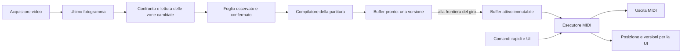

# Esecuzione MIDI per giro

Il runtime della finestra principale usa un produttore e un consumatore. Il produttore interpreta il foglio e prepara una sequenza immutabile di eventi. Il consumatore è l'unico thread che invia note, Clock e trasporto MIDI: legge eventi già ordinati, senza chiamare camera, decoder o interfaccia.



## Termini e scadenze

| Termine | Significato |
| --- | --- |
| Rigo | Riga fisica della griglia; le righe collegate dello stesso gruppo suonano in sequenza. |
| Misura | 2, 3 o 4 pulsazioni, secondo MISURA. |
| Pulsazione | Un quarto, quattro step. Il vecchio nome «battuta» nei payload A–B indica questa unità. |
| Step | Un sedicesimo, sei tick MIDI. |
| Giro | Intero intervallo A–B della struttura attiva. |
| Frontiera | Confine tra due giri; unico punto di sostituzione della partitura durante Play. |

All'inizio dell'ultima misura toccata dal giro, il produttore congela l'ultima osservazione confermata e prepara il prossimo buffer. Per un giro più corto di una misura la scadenza coincide con l'inizio del giro. Una lettura confermata dopo la scadenza viene considerata per una preparazione successiva. Il consumatore continua il giro attivo senza aspettare il produttore; una preparazione tardiva entra a una frontiera successiva e, nel frattempo, si ripete il buffer valido. In Stop una nuova versione confermata viene preparata subito.

Il buffer pronto contiene una sola versione recente, con generazione geometrica e prima frontiera ammessa. Pubblicazioni vecchie non sostituiscono versioni nuove. Un cambio di struttura viene applicato interamente alla frontiera; le note del vecchio giro vengono chiuse prima degli attacchi del nuovo.

## Lettura e comandi

La camera acquisisce indipendentemente dal riconoscimento e conserva un solo frame con ID e timestamp; i lettori possiedono copie separate. Il controllo del foglio avviene normalmente a ogni misura, più l'inizio del giro A–B. In Stop avviene ogni 250 ms; è possibile scegliere una cadenza in pulsazioni. Il decoder riceve davvero i ritagli modificati, mentre il catalogo delle altre zone viene conservato. Anche maschere e misura del corpo lavorano sui righi coinvolti, con coordinate della camera e CAL3 condivise.

Due frame affidabili concordi confermano le modifiche. Un ritorno al riferimento interrompe la candidata; buio e letture incomplete non cancellano le note. La rimozione richiede evidenza di zona vuota e conferma. Sul foglio invariato non vengono richiamati il decoder delle note o il compilatore. «Rileggi foglio» forza un controllo completo in background.

I comandi ottici hanno un worker indipendente: confronto fino a 10 Hz e decodifica solo delle zone cambiate. Il TAP conserva l'istante del primo frame della candidata. La latenza ottica comprende acquisizione, decoder e conferma: il cartoncino STOP può quindi essere più lento del pulsante o dell'ingresso MIDI. Stop/Panic ricevuti dal thread MIDI hanno un canale prioritario e non aspettano il confine del giro.

## Controlli e diagnosi

- **Foglio letto / pronto / in uso:** versioni osservata, preparata e attiva; possono essere diverse durante Play.
- **Verde:** note della partitura attiva. **Blu tratteggiato:** note osservate che attendono l'attivazione. **Rosso:** errore di interpretazione/vincolo; gli esiti di lettura incerta sono riportati nello stato e nel debug.
- **Rileggi foglio:** ripete la lettura senza sostituire direttamente il buffer attivo.
- **Salva tempi MIDI:** esporta nella cartella dell'eseguibile un JSON con gli ultimi 8192 campioni QPC, frequenza, ritardi, durata dell'invio, MMCSS e versioni. Snapshot e scrittura avvengono fuori dal thread MIDI.
- **Debug cartoncini:** conserva le ultime 50 catture delle due corsie; include ID frame, versioni, esiti e ROI effettive. I due registri sono limitati e non contengono immagini.

Il clock Master usa scadenze QPC assolute e MMCSS del solo thread quando disponibile. In Slave l'esecutore segue gli ingressi timestampati e non genera un secondo Clock. Se un ritardo richiederebbe recuperare più tick, il trasporto viene fermato con spegnimenti e segnalazione: occorre riavviare. Non vengono inviati pacchetti di arretrati per nascondere lo stallo. Windows, GC e driver restano sorgenti possibili di ritardo; il doppio buffer garantisce coerenza del contenuto, non una garanzia hard real time.

## Banco temporale isolato

```powershell
dotnet build tools/CollaudoMidi/CollaudoMidi.csproj -p:OutputPath=bin/collaudo
& 'tools/CollaudoMidi/bin/collaudo/CollaudoMidi.exe' --secondi 600 --bpm 60,120,180 --carico entrambi --immagine 'C:/prove/frame.png' --calibrazione 'C:/prove/calibrazione.txt' --output 'TestResults/midi-deterministico/collaudo'
```

`--carico base` esclude la visione; `--carico visione` usa acquisizione simulata da foto locale, pipeline reale, disegno offscreen e rilettura completa ogni 15 s. Non è una prova audio della DAW. Il banco apre esclusivamente la porta **VMBL Test**, se esiste sia in ingresso sia in uscita. Non cambia il routing VMBL/VMBL-DAW. Senza la porta usa un'uscita in memoria e dichiara mancante il loopback; `TargetRaggiunto` richiede anche la corrispondenza dei Clock ricevuti, mentre `TargetLocaleRaggiunto` descrive solo le scadenze locali.

I JSON distinguono ritardo rispetto alla scadenza, scarto degli intervalli, deriva, costo d'invio, conteggi e arresti. Obiettivi di collaudo: p99 del ritardo ≤2 ms, massimo ≤10 ms e nessun overrun nel carico previsto. Sono obiettivi da misurare sul banco, non garanzie ottenute dai test logici. Le immagini della stanza restano locali.
