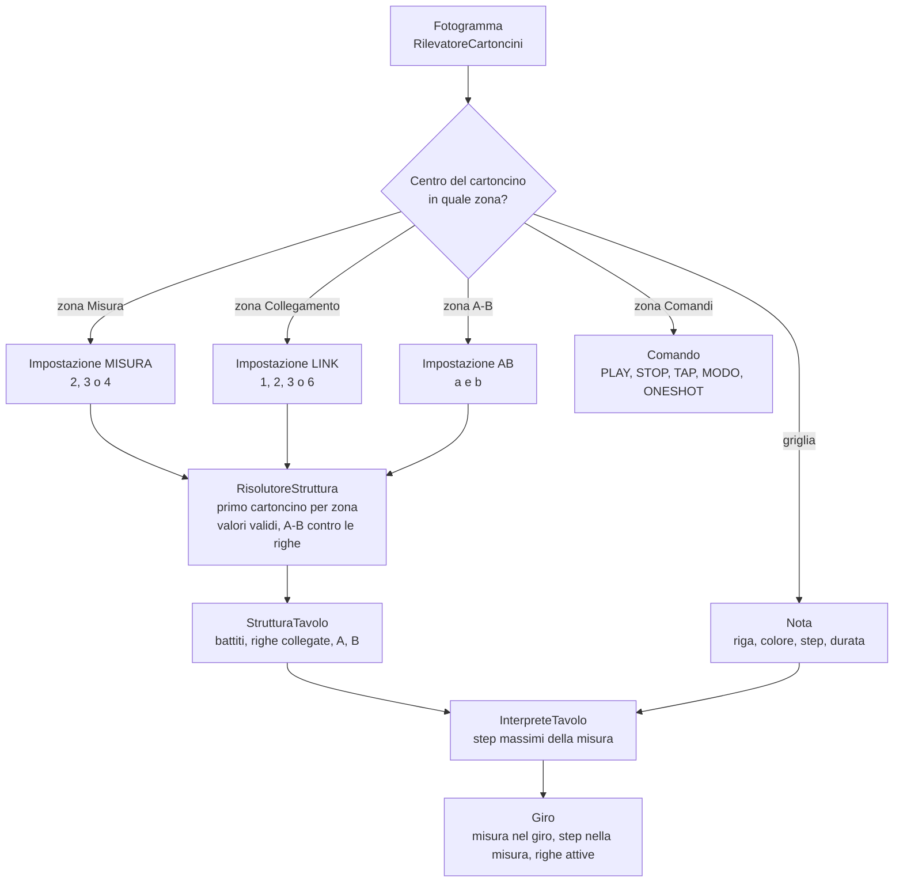
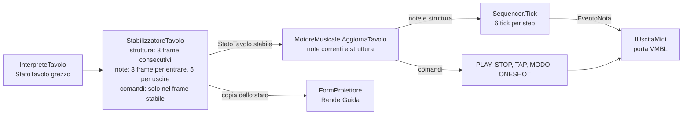
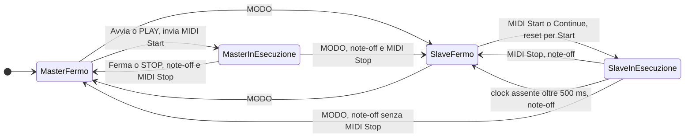
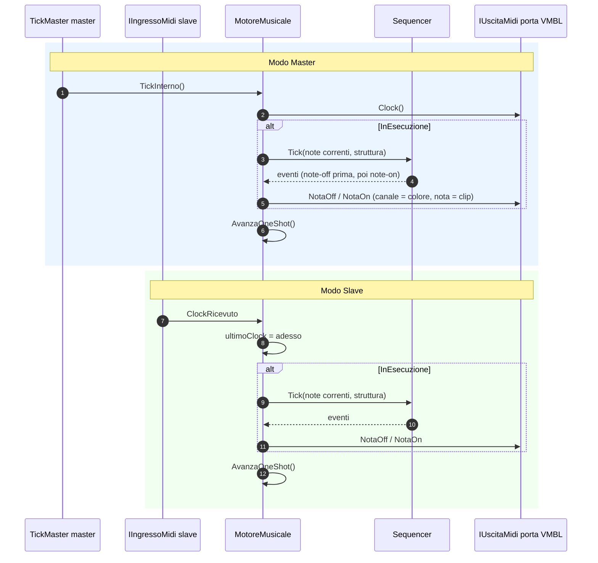

# Funzionigramma

Descrizione funzionale del sistema: come un fotogramma della webcam diventa note MIDI, come le zone del tavolo impostano la struttura del giro (misura, collegamento delle righe, A-B), come il trasporto passa tra Master e Slave, e che effetto hanno i cartoncini comando. Tutto è ricavato dal codice (`src/Core`, `src/Vision`, `src/Midi`, `src/App`).

## Thread e cadenze

| Thread | Classe | Cadenza | Ruolo |
|---|---|---|---|
| Cattura | `CicloCattura` | circa 66 ms (circa 15 fps) | Esegue `Compositore.Passo`: visione, interpretazione, stabilizzazione, motore. |
| Clock interno | `TickMaster` | priorità alta, un tick ogni 60000 / (BPM x 24) ms | Chiama `MotoreMusicale.TickInterno` in Master; controlla il timeout del clock esterno ogni 100 ms. |
| MIDI in ingresso | libreria DryWetMIDI | su evento | Solleva `ClockRicevuto`, `StartRicevuto`, `StopRicevuto`, `ContinueRicevuto`. |
| Interfaccia | `FormControllo` | timer di 150 ms (aggiornamento etichette e anteprima) | Pulsanti, anteprima webcam, calibrazione. Passa a `FormProiettore` lo stato e la posizione del giro (`MotoreMusicale.Posizione`). |
| Proiezione | `FormProiettore` | su richiesta (`Invalidate` a ogni passo di cattura) | Disegno della guida tramite `RenderGuida`. |

Lo stato del motore è protetto da un unico lock (`MotoreMusicale.bloccoLock`).

## Un fotogramma: cartoncini -> zone -> struttura

Il centro di ogni cartoncino rilevato decide a quale zona appartiene. Le zone sono coordinate normalizzate del tavolo (0..1), definite in `LayoutTavolo.Default`.

Passi principali:

1. `Compositore.Passo` chiede i cartoncini al rilevatore. Se il rilevatore lancia un'eccezione (webcam momentaneamente assente) il passo viene saltato e lo stato resta invariato.
2. `RilevatoreCartoncini` decodifica i QR, misura il corpo colorato (colore dalla tonalità HSV) e ricava l'area sul tavolo.
3. `InterpreteTavolo` classifica ogni cartoncino per zona e ne legge il payload. Nelle zone Misura, Collegamento e A-B si trovano le impostazioni: `RisolutoreStruttura` ricava la `StrutturaTavolo` (il primo cartoncino per zona vale, gli altri sono sovrapposti). Nella zona Comandi si trovano i comandi; altrove le note. Le note sono interpretate con gli step massimi della misura.
4. `StabilizzatoreTavolo` filtra lo sfarfallio. La struttura cambia solo dopo 3 frame consecutivi con lo stesso valore diverso. Le note entrano dopo 3 frame e escono dopo 5 di assenza. I comandi sono esposti solo nel frame in cui diventano stabili.
5. `MotoreMusicale.AggiornaTavolo` sostituisce le note correnti, la struttura ed esegue i comandi.
6. `FormProiettore.Aggiorna` riceve una copia dello stato e la posizione del giro, e ridisegna la guida.

## Layout del tavolo

| Zona | Rettangolo (x, y, larghezza, altezza) | Contenuto |
|---|---|---|
| Misura | (0,01; 0,04; 0,12; 0,28) | Impostazione `MISURA`: 2, 3 o 4 battiti. |
| Collegamento | (0,01; 0,36; 0,12; 0,28) | Impostazione `LINK`: 1, 2, 3 o 6 righe per gruppo. |
| A-B | (0,01; 0,68; 0,12; 0,28) | Impostazione `AB`: intervallo di righe da A a B. |
| Griglia | (0,15; 0,04; 0,67; 0,92) | 6 righe x 16 colonne (`LayoutTavolo.AreaGrigliaDefault`). Note. |
| Comandi | (0,84; 0,04; 0,14; 0,92) | Comandi (`Compositore.ZonaComandiDefault`). |

Un cartoncino appartiene a una zona se il suo centro cade nel rettangolo. L'ordine di controllo è Misura, Collegamento, A-B, Comandi; altrimenti è nella griglia. La griglia è più stretta della versione precedente (0,67 invece di 0,80 della larghezza): lo step proiettato è circa il 16% più stretto.

## Struttura del giro

`StrutturaTavolo` contiene quattro valori: `BattitiPerMisura` (2, 3 o 4), `RigheCollegate` (1, 2, 3 o 6), `AInizio` e `AFine` (A-B, 1-based, dentro il gruppo). Il default è 4/4, 6 righe collegate, A-B `[1, 6]`.

- **Riga = misura.** Una riga ha `StepPerMisura = 4 x battiti` colonne (sedicesimi): 16, 12 o 8. Le colonne fisiche restano 16; in 3/4 e 2/4 le colonne oltre la misura sono oscurate e le note che iniziano lì sono scartate (`FuoriMisura`).
- **Colore = strumento.** Il colore del cartoncino determina il canale MIDI (`Traccia` = indice del colore). Nella stessa riga si possono mescolare colori diversi.
- **Gruppi.** Le 6 righe sono divise in `NumeroGruppi = 6 / RigheCollegate` gruppi consecutivi. Dentro un gruppo le righe suonano in sequenza (misure consecutive); gruppi diversi suonano in contemporanea.
- **A-B.** Il giro ripete solo le righe da `AInizio` a `AFine` di ogni gruppo.

### Formule di posizione

Dato lo step assoluto `s` (sedicesimi dall'avvio, 6 tick per step), `PosizioneGiro` è:

| Grandezza | Formula | Esempio: default (4/4, 6 righe, A-B 1-6), `s = 20` | Esempio: LINK 2 (A-B 1-2), `s = 16` |
|---|---|---|---|
| `LunghezzaGiro` (misure) | `AFine - AInizio + 1` | 6 | 2 |
| `misuraNelGiro` | `(s / StepPerMisura) mod LunghezzaGiro` | `(20 / 16) mod 6 = 1` | `(16 / 16) mod 2 = 1` |
| `stepInMisura` | `s mod StepPerMisura` | `20 mod 16 = 4` | `16 mod 16 = 0` |
| riga attiva del gruppo `k` (0-based) | `k x RigheCollegate + (AInizio - 1) + misuraNelGiro` | riga 1 (0-based), gruppo 0 | gruppi 0, 1, 2: righe 1, 3, 5 (0-based) |

Una nota suona quando la sua riga è attiva e il suo step iniziale è uguale a `stepInMisura`. Termina al più tardi a fine misura: la durata è troncata a `StepPerMisura - StepIniziale`.

## Stati di trasporto: Master, Slave, in esecuzione

Il trasporto è in uno dei quattro stati: Master o Slave, con la sequenza ferma o in esecuzione. Gli stati sono derivati da `MotoreMusicale` (`Modo`, `InEsecuzione`).

Regole collegate:

- In **Master** il clock viene inviato in continuo (`uscita.Clock()` a ogni tick), anche da fermo. Il sequencer avanza solo se in esecuzione.
- In **Slave** il sequencer avanza a ogni clock ricevuto; `Start` riparte da zero. Senza clock per più di 500 ms la riproduzione si ferma da sola (`ControllaTimeoutClock`).
- `Avvia`, `Ferma`, `Tap` funzionano solo in Master. In Slave il pulsante Tap è disabilitato.
- Il cambio di modo ferma sempre la riproduzione.

## Un tick: clock -> sequencer -> MIDI

Il sequencer produce un tick su 6 (`Sequencer.TickPerStep`) con un passo (sedicesimo). A 24 tick per battuta, 6 tick per passo significano un passo di sedicesimo.

Dentro `Sequencer.Tick`, in quest'ordine:

- Se la struttura è cambiata rispetto al tick precedente, tutte le note in corso ricevono subito il note-off: nessuna nota resta appesa. La riproduzione prosegue sullo step assoluto in corso.
- Ogni tick: le note che non sono più sulla griglia ricevono subito il note-off.
- Ai multipli di 6 tick (confine di passo) si calcola la posizione nel giro (`PosizioneGiro`), si spengono le note giunte alla fine della durata e si accendono le note che iniziano sul passo corrente, con la riga attiva. A parità, ordine per colore (traccia), clip e riga.
- Una nota già in corso, identificata dalla chiave `IdClip:Traccia:Riga:StepIniziale`, non viene riaccesa finché suona.
- La durata minima è 1 passo, troncata a fine misura.

Mappatura verso MIDI (`MappaturaMidiJson`): canale = `CanalePerTraccia[traccia]` (0-based, la traccia è il colore), nota = `NotaPerClip[idClip]` oppure `36 + idClip`, velocity = `Velocity` (default 100).

## Cartoncini comando

I comandi sono letti solo nella zona comandi. Sono eseguiti una volta, quando diventano stabili.

| Payload | Effetto in Master | Effetto in Slave | Note |
|---|---|---|---|
| `VMBL1;C;PLAY` | Se fermo: `InEsecuzione = true`, invia MIDI Start. | Ignorato. | Se già in esecuzione non fa nulla. |
| `VMBL1;C;STOP` | Se in esecuzione: `InEsecuzione = false`, note-off delle note in corso, invia MIDI Stop. | Ignorato. | Se fermo non fa nulla. |
| `VMBL1;C;TAP` | Registra un tap: il BPM è la media degli ultimi 4 intervalli (30-300 BPM). | Ignorato. | Una pausa superiore a 2 s azzera il calcolo. |
| `VMBL1;C;MODO` | Passa a Slave, ferma la riproduzione (con MIDI Stop se era in esecuzione). | Passa a Master, ferma la riproduzione (senza MIDI Stop). | Vedi il diagramma degli stati. |
| `VMBL1;C;ONESHOT;n` | Note-on della nota `n` sul canale della traccia 0, note-off dopo 6 tick di clock. | Come Master, ma i tick arrivano dal clock esterno. | `n` tra 0 e 127; una nota già accesa viene riarmata. |

Cartoncini di nota nella zona comandi, o comandi fuori dalla zona, producono errori (vedi sotto), non effetti.

## Cartoncini speciali

I cartoncini speciali impostano la struttura del giro. Il payload è `VMBL1;S;<chiave>;<valori>`: la chiave deve corrispondere alla zona in cui è posato. Sono 22, stampabili da `assets/cartoncini/` (`speciale-*.png`), con corpo viola-grigio (135, 115, 150) e senza colore di traccia.

| File | Payload | Zona | Etichetta | Significato |
|---|---|---|---|---|
| `speciale-misura-2.png` | `VMBL1;S;MISURA;2` | Misura | 2/4 | 2 battiti per misura (8 sedicesimi) |
| `speciale-misura-3.png` | `VMBL1;S;MISURA;3` | Misura | 3/4 | 3 battiti per misura (12 sedicesimi) |
| `speciale-misura-4.png` | `VMBL1;S;MISURA;4` | Misura | 4/4 | 4 battiti, default |
| `speciale-link-1.png` | `VMBL1;S;LINK;1` | Collegamento | 1 riga | 6 gruppi da una riga: sei righe in parallelo |
| `speciale-link-2.png` | `VMBL1;S;LINK;2` | Collegamento | 2 righe | 3 gruppi da 2 righe, in sequenza dentro il gruppo |
| `speciale-link-3.png` | `VMBL1;S;LINK;3` | Collegamento | 3 righe | 2 gruppi da 3 righe |
| `speciale-link-6.png` | `VMBL1;S;LINK;6` | Collegamento | 6 righe | 1 gruppo da 6 righe, default |
| `speciale-ab-1-2.png` | `VMBL1;S;AB;1;2` | A-B | A-B 1-2 | il giro ripete le righe 1-2 del gruppo |
| `speciale-ab-1-3.png` | `VMBL1;S;AB;1;3` | A-B | A-B 1-3 | il giro ripete le righe 1-3 |
| `speciale-ab-1-4.png` | `VMBL1;S;AB;1;4` | A-B | A-B 1-4 | il giro ripete le righe 1-4 |
| `speciale-ab-1-5.png` | `VMBL1;S;AB;1;5` | A-B | A-B 1-5 | il giro ripete le righe 1-5 |
| `speciale-ab-1-6.png` | `VMBL1;S;AB;1;6` | A-B | A-B 1-6 | il giro ripete le righe 1-6 (default) |
| `speciale-ab-2-3.png` | `VMBL1;S;AB;2;3` | A-B | A-B 2-3 | il giro ripete le righe 2-3 |
| `speciale-ab-2-4.png` | `VMBL1;S;AB;2;4` | A-B | A-B 2-4 | il giro ripete le righe 2-4 |
| `speciale-ab-2-5.png` | `VMBL1;S;AB;2;5` | A-B | A-B 2-5 | il giro ripete le righe 2-5 |
| `speciale-ab-2-6.png` | `VMBL1;S;AB;2;6` | A-B | A-B 2-6 | il giro ripete le righe 2-6 |
| `speciale-ab-3-4.png` | `VMBL1;S;AB;3;4` | A-B | A-B 3-4 | il giro ripete le righe 3-4 |
| `speciale-ab-3-5.png` | `VMBL1;S;AB;3;5` | A-B | A-B 3-5 | il giro ripete le righe 3-5 |
| `speciale-ab-3-6.png` | `VMBL1;S;AB;3;6` | A-B | A-B 3-6 | il giro ripete le righe 3-6 |
| `speciale-ab-4-5.png` | `VMBL1;S;AB;4;5` | A-B | A-B 4-5 | il giro ripete le righe 4-5 |
| `speciale-ab-4-6.png` | `VMBL1;S;AB;4;6` | A-B | A-B 4-6 | il giro ripete le righe 4-6 |
| `speciale-ab-5-6.png` | `VMBL1;S;AB;5;6` | A-B | A-B 5-6 | il giro ripete le righe 5-6 |

Le 15 coppie A-B hanno `1 <= a < b <= 6`. Un A-B è valido solo se `b` non supera le righe collegate: con `LINK 2` sono validi solo `1-2`; con `LINK 1` l'A-B non si applica.

Regole di posa e di risoluzione:

- Ogni zona accetta un cartoncino. Se ce ne sono più, vale quello più in alto (poi quello più a sinistra); gli altri sono segnalati come `Sovrapposto` e ignorati.
- Un valore fuori dall'insieme ammesso, o un A-B non valido, produce `ImpostazioneNonValida`: il cartoncino è ignorato e il parametro vale il default (per l'A-B `[1, RigheCollegate]`).
- Senza cartoncino in una zona vale il default di quel parametro.

## Errori e scarti

| Errore (`TipoErrore`) | Condizione | Causa tipica | Come si corregge | Effetto sulla guida |
|---|---|---|---|---|
| `PayloadNonValido` | QR non riconosciuto come VMBL1 valido; nota nella zona Comandi; comando nella griglia o nelle zone speciali. | QR non leggibile, cartoncino nel posto sbagliato. | Verificare il cartoncino e la sua posizione. | Contorno rosso sull'area. |
| `ColoreMancante` | Colore non classificabile: saturazione sotto 0,35 o valore sotto 0,25. | Proiettore sovraesposto, cartoncino sbiadito. | Ridurre la luce ambiente, usare cartoncini più saturi. | Contorno rosso. |
| `FuoriGriglia` | Centro della nota fuori dalle 6 righe o dalle 16 colonne; nota posata in una zona speciale. | Cartoncino fuori dalla griglia o nella colonna sinistra. | Riposizionare il cartoncino nella griglia. | Contorno rosso. |
| `Sovrapposto` | Note con la stessa riga e lo stesso colore che si sovrappongono nei passi (la prima in ordine di posizione resta); oppure più cartoncini nella stessa zona speciale. | Due cartoncini nella stessa posizione. | Spostare o accorciare una delle due note; lasciare un solo cartoncino per zona. | Contorno rosso. |
| `ImpostazioneNonValida` | Impostazione fuori dall'insieme ammesso (misura diversa da 2, 3, 4; collegamento diverso da 1, 2, 3, 6); A-B con `a >= b`, con `b` oltre le righe collegate o con `LINK 1`. | Cartoncino non previsto (es. `MISURA;5`, `AB;4;2`, `AB;2;5` con `LINK 3`). | Usare un cartoncino della tabella dei cartoncini speciali. Il parametro vale il default. | Contorno rosso sul cartoncino. |
| `FuoriMisura` | Nota che inizia oltre il numero di colonne della misura (in 3/4 dalla colonna 13; in 2/4 dalla colonna 9). | Nota nelle colonne oscurate. | Spostare la nota nelle colonne attive della misura, oppure usare 4/4. | Contorno rosso. |

Gli errori non vengono filtrati dallo stabilizzatore: passano subito alla guida. Il colore non è più legato alla riga.

## Riferimenti

- Payload e parser: `src/Core/ParserPayload.cs`, `src/Core/PayloadCartoncino.cs`.
- Struttura del tavolo: `src/Core/StrutturaTavolo.cs`, `src/Core/RisolutoreStruttura.cs`, `src/Core/LayoutTavolo.cs`.
- Griglia e interpretazione: `src/Core/Griglia.cs`, `src/Core/InterpreteTavolo.cs`, `src/Core/StabilizzatoreTavolo.cs`.
- Sequencer e motore: `src/Core/Sequencer.cs`, `src/Core/MotoreMusicale.cs`.
- Visione: `src/Vision/RilevatoreCartoncini.cs`, `src/Vision/ClassificatoreColore.cs`.
- Composizione: `src/App/Compositore.cs`. Guida proiettata: `src/App/RenderGuida.cs`, `src/App/FormProiettore.cs`.
- Mockup della guida: `docs/mockup-proiezione.md`.
- Procedura di prova: `docs/prova-hardware.md`.
