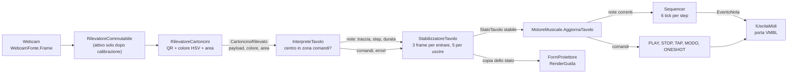
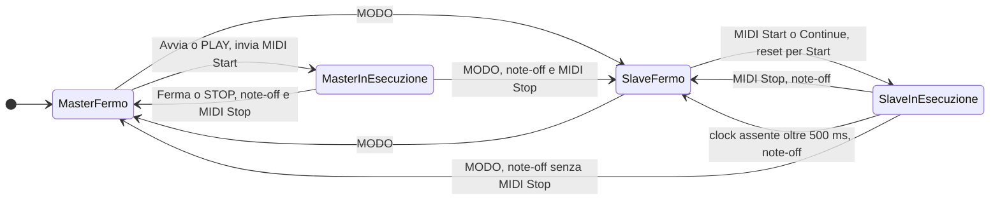

# Funzionigramma

Descrizione funzionale del sistema: come un fotogramma della webcam diventa note MIDI, come il trasporto passa tra Master e Slave, e che effetto hanno i cartoncini comando. Tutto è ricavato dal codice (`src/Core`, `src/Vision`, `src/Midi`, `src/App`).

## Thread e cadenze

| Thread | Classe | Cadenza | Ruolo |
|---|---|---|---|
| Cattura | `CicloCattura` | circa 66 ms (circa 15 fps) | Esegue `Compositore.Passo`: visione, interpretazione, stabilizzazione, motore. |
| Clock interno | `TickMaster` | priorità alta, un tick ogni 60000 / (BPM x 24) ms | Chiama `MotoreMusicale.TickInterno` in Master; controlla il timeout del clock esterno ogni 100 ms. |
| MIDI in ingresso | libreria DryWetMIDI | su evento | Solleva `ClockRicevuto`, `StartRicevuto`, `StopRicevuto`, `ContinueRicevuto`. |
| Interfaccia | `FormControllo`, `FormProiettore` | evento / timer 150 ms | Pulsanti, anteprima, disegno della guida. |

Lo stato del motore è protetto da un unico lock (`MotoreMusicale.bloccoLock`).

## Un fotogramma: webcam -> note

Passi principali:

1. `Compositore.Passo` chiede i cartoncini al rilevatore. Se il rilevatore lancia un'eccezione (webcam momentaneamente assente) il passo viene saltato e lo stato resta invariato.
2. `RilevatoreCartoncini` decodifica i QR, misura il corpo colorato (colore dalla tonalità HSV) e ricava l'area sul tavolo.
3. `InterpreteTavolo` decide per ogni cartoncino se è un comando (centro nella zona comandi, default x 0,84-0,98) o una nota (griglia). La traccia viene dalla riga del centro verticale, lo step iniziale dal bordo sinistro, la durata dalla larghezza in passi.
4. `StabilizzatoreTavolo` (default: 3 frame per diventare stabile, 5 per essere rimossa) filtra lo sfarfallio. I comandi sono esposti solo nel frame in cui diventano stabili.
5. `MotoreMusicale.AggiornaTavolo` sostituisce le note correnti ed esegue i comandi.
6. `FormProiettore.Aggiorna` riceve una copia dello stato e ridisegna la guida.

## Stati di trasporto: Master, Slave, in esecuzione

Il trasporto è in uno dei quattro stati: Master o Slave, con la sequenza ferma o in esecuzione. Gli stati sono derivati da `MotoreMusicale` (`Modo`, `InEsecuzione`).

Regole collegate:

- In **Master** il clock viene inviato in continuo (`uscita.Clock()` a ogni tick), anche da fermo. Il sequencer avanza solo se in esecuzione.
- In **Slave** il sequencer avanza a ogni clock ricevuto; `Start` riparte da zero. Senza clock per più di 500 ms la riproduzione si ferma da sola (`ControllaTimeoutClock`).
- `Avvia`, `Ferma`, `Tap` funzionano solo in Master. In Slave il pulsante Tap è disabilitato.
- Il cambio di modo ferma sempre la riproduzione.

## Un tick: clock -> sequencer -> MIDI

Il sequencer produce un tick su 6 (`Sequencer.TickPerStep`) con un passo della griglia. A 24 tick per battuta, 6 tick per passo significano un passo di sedicesimo.

Dentro `Sequencer.Tick`:

- Ogni tick: le note che non sono più sulla griglia ricevono subito il note-off.
- Ai multipli di 6 tick (confine di passo) si spengono le note giunte alla fine della durata e si accendono le note che iniziano sul passo corrente, in ordine di traccia e clip.
- La durata minima è 1 passo, troncata a fine griglia.

Mappatura verso MIDI (`MappaturaMidiJson`): canale = `CanalePerTraccia[traccia]` (0-based), nota = `NotaPerClip[idClip]` oppure `36 + idClip`, velocity = `Velocity` (default 100).

## Cartoncini comando

I comandi sono letti solo nella zona comandi. Sono eseguiti una volta, quando diventano stabili.

| Payload | Effetto in Master | Effetto in Slave | Note |
|---|---|---|---|
| `VMBL1;C;PLAY` | Se fermo: `InEsecuzione = true`, invia MIDI Start. | Ignorato. | Se già in esecuzione non fa nulla. |
| `VMBL1;C;STOP` | Se in esecuzione: `InEsecuzione = false`, note-off delle note in corso, invia MIDI Stop. | Ignorato. | Se fermo non fa nulla. |
| `VMBL1;C;TAP` | Registra un tap: il BPM è la media degli ultimi 4 intervalli (30-300 BPM). | Ignorato. | Una pausa superiore a 2 s azzera il calcolo. |
| `VMBL1;C;MODO` | Passa a Slave, ferma la riproduzione (con MIDI Stop se era in esecuzione). | Passa a Master, ferma la riproduzione (senza MIDI Stop). | Vedi il diagramma degli stati. |
| `VMBL1;C;ONESHOT;n` | Note-on della nota `n` sul canale della traccia 0, note-off dopo 6 tick di clock. | Come Master, ma i tick arrivano dal clock esterno. | `n` tra 0 e 127; una nota già accesa viene riarmata. |

Cartoncini di nota nella zona comandi, o comandi fuori dalla zona, producono errori (vedi sotto), non effetti.

## Errori e scarti

| Errore (`TipoErrore`) | Condizione | Effetto sulla guida |
|---|---|---|
| `PayloadNonValido` | QR non riconosciuto come VMBL1 valido, nota nella zona comandi, comando fuori dalla zona. | Contorno rosso sull'area. |
| `ColoreMancante` | Colore non classificabile: saturazione sotto 0,35 o valore sotto 0,25. | Contorno rosso. |
| `ColoreIncoerente` | Colore diverso dalla traccia della riga in cui si trova. | Contorno rosso. |
| `FuoriGriglia` | Centro della riga fuori dalle 6 tracce o step iniziale fuori dalle 16 colonne. | Contorno rosso. |
| `Sovrapposto` | Note sulla stessa traccia che si sovrappongono nei passi (la prima in ordine di posizione resta). | Contorno rosso. |

Gli errori non vengono filtrati dallo stabilizzatore: passano subito alla guida.

## Riferimenti

- Payload e parser: `src/Core/ParserPayload.cs`, `src/Core/PayloadCartoncino.cs`.
- Griglia e interpretazione: `src/Core/Griglia.cs`, `src/Core/InterpreteTavolo.cs`.
- Sequencer e motore: `src/Core/Sequencer.cs`, `src/Core/MotoreMusicale.cs`.
- Visione: `src/Vision/RilevatoreCartoncini.cs`, `src/Vision/ClassificatoreColore.cs`.
- Mockup della guida: `docs/mockup-proiezione.md`.
- Procedura di prova: `docs/prova-hardware.md`.
