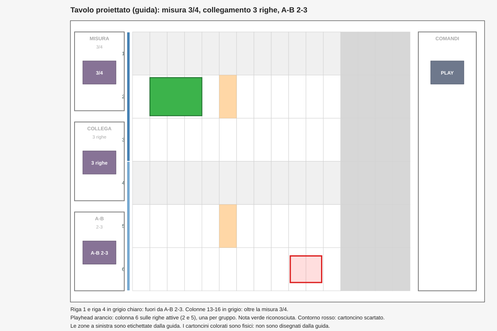

# Mockup della proiezione

Questo documento mostra come appare il tavolo proiettato dalla guida (`FormProiettore` + `RenderGuida`). Il mockup è in `docs/mockup-proiezione.svg`.

Lo scenario del mockup: misura 3/4 (`speciale-misura-3`), collegamento a 3 righe (`speciale-link-3`), A-B 2-3 (`speciale-ab-2-3`), playhead sulla sesta colonna, una nota riconosciuta, un cartoncino scartato e la zona comandi.

## Layout del tavolo

Coordinate normalizzate del tavolo (0..1), da `LayoutTavolo.Default` e `LayoutTavolo.AreaGrigliaDefault`:

| Zona | Rettangolo (x, y, larghezza, altezza) | Etichetta e valore disegnati dalla guida |
|---|---|---|
| Misura | (0,01; 0,04; 0,12; 0,28) | «MISURA» e il valore (`3/4`, `2/4`, `4/4`) |
| Collegamento | (0,01; 0,36; 0,12; 0,28) | «COLLEGA» e le righe (`1 righe`, `2 righe`, `3 righe`, `6 righe`) |
| A-B | (0,01; 0,68; 0,12; 0,28) | «A-B» e l'intervallo (`1-6`, `2-3`, ...) |
| Griglia (6 righe x 16 colonne) | (0,15; 0,04; 0,67; 0,92) | Celle, barre di gruppo, numeri di riga, note, errori |
| Comandi | (0,84; 0,04; 0,14; 0,92) | «COMANDI», senza valore |

La griglia occupa il 67% della larghezza (prima 80%): lo step proiettato è circa il 16% più stretto.

## Elementi disegnati dalla guida

La guida è disegnata da `RenderGuida.Disegna` sull'intero schermo del proiettore, in quest'ordine:

| Elemento | Quando | Colore (RGB) | Dettaglio |
|---|---|---|---|
| Fondo | sempre | bianco (255, 255, 255) | `Color.White`: il tavolo è la zona bianca proiettata. |
| Zone speciali | con il layout | contorno grigio (128, 128, 128), spessore 2; etichetta e valore grigio scuro (169, 169, 169) | Zone Misura, Collegamento, A-B e Comandi. |
| Celle | sempre | contorno grigio chiaro (211, 211, 211), 1 px | 6 righe x 16 colonne. |
| Colonne oltre la misura | se lo step è oltre `StepPerMisura` | grigio (215, 215, 215) | Con 3/4 le colonne 13-16, con 2/4 le colonne 9-16. |
| Righe fuori da A-B | se la riga non è nell'intervallo A-B del gruppo | grigio molto chiaro (240, 240, 240) | Le righe in posizione fuori da A-B non suonano. |
| Barre di gruppo | per ogni gruppo di righe collegate | blu (70, 130, 180) e blu chiaro (120, 170, 210), alternati | Barra sul lato sinistro della griglia, larga 6 px, che unisce le righe del gruppo. |
| Numeri di riga | sempre | grigio ardesia scuro (47, 79, 79) | 1..6, da sinistra a destra nella colonna a sinistra della griglia. |
| Playhead | sulle righe attive, nella colonna `stepInMisura` | arancio (255, 140, 0) con opacità circa 35% quando in esecuzione | Una riga per gruppo. Fermo: solo contorno grigio (128, 128, 128). |
| Nota riconosciuta | per ogni nota stabile | riempimento verde (60, 179, 75), bordo verde scuro (30, 110, 45) spessore 2 | Da step iniziale per la durata in step (troncata a fine misura). |
| Errore | per ogni cartoncino scartato | riempimento rosso chiaro (255, 120, 120) con opacità circa 24%, bordo rosso (220, 30, 30) spessore 3 | Disegnato sull'area reale del cartoncino, non sulla cella. |

## Elementi fisici (non disegnati dalla guida)

- **Cartoncini speciali**: si posano nelle tre zone a sinistra, con il centro del cartoncino nella zona. Il corpo è viola-grigio (135, 115, 150). Nel mockup il cartoncino `speciale-misura-3`, `speciale-link-3` e `speciale-ab-2-3` è mostrato come riferimento.
- **Zona comandi**: fascia destra del tavolo, x da 0,84 a 0,98, y da 0,04 a 0,96 (`Compositore.ZonaComandiDefault`). Un cartoncino è un comando se il suo centro cade in questa zona. La guida la disegna solo come cornice con l'etichetta «COMANDI»: il cartoncino PLAY nel mockup è fisico.
- **Cartoncini**: sono sul tavolo fisico, non sul proiettore.
- **Etichette di testo dei cartoncini** (nomi, «PLAY»): nel mockup sono annotazioni del documento. `RenderGuida` non disegna il testo dei cartoncini.

## Lettura del mockup

- **Zone a sinistra**: la misura è 3/4 (valore «3/4»), il collegamento è a 3 righe (gruppi da 3: righe 1-3 e 4-6), l'A-B è 2-3.
- **Barre di gruppo**: la barra scura unisce le righe 1-3, quella chiara le righe 4-6.
- **Righe fuori da A-B**: con A-B 2-3 la prima riga di ogni gruppo, cioè le righe 1 e 4, è in grigio chiaro e non suona.
- **Colonne oltre la misura**: con 3/4 le colonne 13-16 sono in grigio. Una nota che inizia lì sarebbe scartata come `FuoriMisura`.
- **Playhead** sulla colonna 6 (indice 5) solo nelle righe attive: la riga 2 e la riga 5, una per gruppo. Le altre righe della colonna non sono evidenziate.
- **Nota verde**: il cartoncino è sulla riga 2, parte dal secondo passo e dura 3 passi. Il colore del cartoncino non è più legato alla riga: il canale MIDI dipende dal colore.
- **Contorno rosso** nella riga 6: un cartoncino scartato, per esempio per `Sovrapposto` o `FuoriMisura`. Il motivo dello scarto è nella tabella della prova hardware (`docs/prova-hardware.md`, sezione 9).
- **Zona comandi** a destra: i cartoncini comando (PLAY, STOP, TAP, MODO, ONESHOT) sono letti dalla zona e non diventano note.

## Coerenza con il codice

- Colori e dimensioni: `src/App/RenderGuida.cs`.
- Zone e griglia: `src/Core/LayoutTavolo.cs` (`Default`, `AreaGrigliaDefault`), `src/App/Compositore.cs` (`ZonaComandiDefault`), `src/App/Program.cs` (`ConfigGriglia.Area`).
- Righe attive e colonne oltre la misura: `src/Core/StrutturaTavolo.cs` (`Posizione`).
- Tracce, step e colori dei cartoncini: `src/Core/ColoreTraccia.cs`, `src/Core/ConfigGriglia.cs`, `assets/cartoncini/LEGGIMI.md`.
